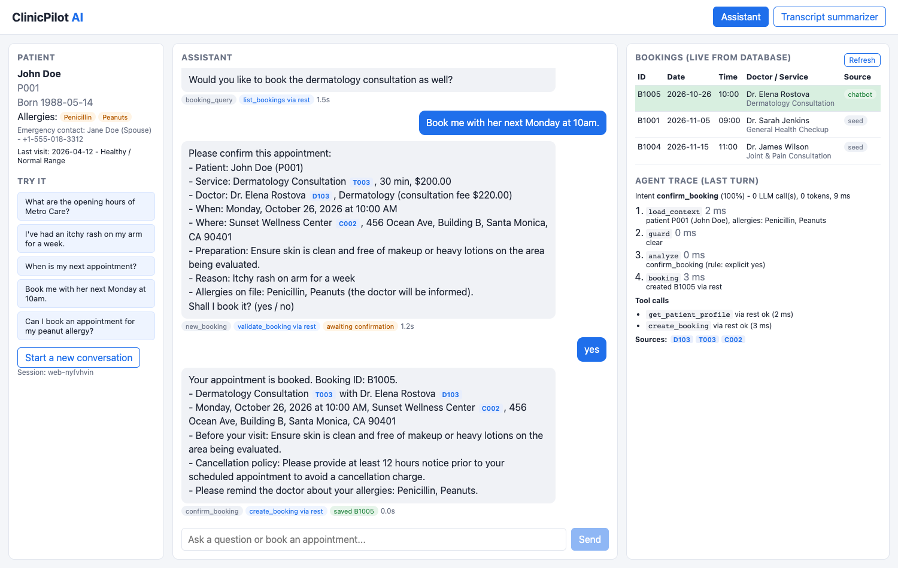

# ClinicPilot AI

An AI clinic assistant MVP. A patient chats in natural language to ask about clinics and doctors, get treatment recommendations, check existing appointments, and book a new appointment, which is saved to a database and appears live in the UI.



**Highlights**
- **Explicit LangGraph state machine** for intent routing and multi-turn slot filling; the booking is written only after the patient confirms a summary rendered from database values.
- **Tool calling over REST or MCP** (switch with one env var); both paths share the same validated backend endpoints.
- **Hybrid retrieval** (BM25 + LLM-inferred specialty, fused with RRF) with citations checked against retrieved sources.
- **Deterministic guardrails**: emergency short-circuit, medical scope, prompt-injection handling, clinic opening-hours / specialty / date validation, idempotent booking creation.
- **Agent trace panel** in the UI: intent, steps, tool calls, sources, tokens and latency for every turn.
- **Tested and evaluated**: 51 automated tests (offline, run in CI), a 30-scenario evaluation against the real LLM, and a black-box QA pass of 55 conversations whose findings were fixed and added as regression tests.
- Bonus: transcript summarizer, Langfuse tracing, Docker Compose, Kubernetes manifests.

Design details, trade-offs and results: **[TECH_DOC.md](TECH_DOC.md)**.

## Repository structure

```text
├── ai-service/        # Python: LangGraph agent, retrieval, tools (REST + MCP server), FastAPI
├── backend/           # NestJS + Prisma + SQLite: data, booking rules, chat gateway
├── frontend/          # React + Vite: chat, live bookings, agent trace, summarizer
├── mock-data/         # Provided CSV datasets (seed source)
├── evals/             # Scenario evaluation (cases + runner + latest report)
├── scripts/           # setup.sh, dev.sh
├── k8s/               # Reference Kubernetes manifests
├── docker-compose.yml
├── TECH_DOC.md
└── README.md
```

## Prerequisites

- **Node.js 20+** (tested with 22) and npm
- **Python 3.11+** (tested with 3.12; CI runs 3.11 and 3.12)
- macOS or Linux shell (on Windows, use WSL)
- An LLM API key for an **OpenAI-compatible** endpoint. Defaults are set for **DeepSeek** (`deepseek-chat`). OpenAI works by changing three variables; Anthropic is supported via `pip install langchain-anthropic` and `LLM_PROVIDER=anthropic`.

## Quick start (local, recommended for the demo)

```bash
git clone https://github.com/xdis/clinicpilot-ai.git
cd clinicpilot-ai

./scripts/setup.sh            # installs all dependencies, creates the SQLite DB and seeds it from mock-data/
# edit ai-service/.env and set LLM_API_KEY=...
./scripts/dev.sh              # starts backend :3000, AI service :8000, frontend :5173
```

Open **http://localhost:5173**. Swagger API docs: **http://localhost:3000/api/docs**.

`make setup`, `make dev`, `make test`, `make eval`, `make demo-reset` and `make docker` wrap the same commands.

### Environment variables

`ai-service/.env` (copy from `.env.example`):

| Variable | Default | Notes |
|---|---|---|
| `LLM_PROVIDER` | `deepseek` | `deepseek` \| `openai` \| `anthropic` \| `fake` (offline, tests only) |
| `LLM_MODEL` | `deepseek-chat` | e.g. `gpt-4o-mini` for OpenAI |
| `LLM_API_KEY` | - | **required** |
| `LLM_BASE_URL` | `https://api.deepseek.com` | empty for OpenAI / Anthropic defaults |
| `BACKEND_URL` | `http://localhost:3000/api` | |
| `TOOL_TRANSPORT` | `rest` | `mcp` routes every tool call through the bundled MCP server |
| `CLINIC_TODAY` | (real date) | pin "today" (YYYY-MM-DD) for a reproducible demo |
| `LANGFUSE_PUBLIC_KEY` / `LANGFUSE_SECRET_KEY` / `LANGFUSE_HOST` | - | optional tracing |

`backend/.env` (copy from `.env.example`): `DATABASE_URL="file:./dev.db"`, `PORT=3000`, `AI_SERVICE_URL=http://localhost:8000`. Optionally `CLINIC_TODAY` (must match the AI service if set).

### Manual setup (what the scripts do)

```bash
# 1) Backend: database + API
cd backend
cp .env.example .env
npm install
npm run db:setup              # prisma migrate deploy + seed from ../mock-data (idempotent)
npm run start:dev             # http://localhost:3000/api

# 2) AI service
cd ../ai-service
python3 -m venv .venv
.venv/bin/pip install -r requirements-dev.txt
cp .env.example .env          # set LLM_API_KEY
.venv/bin/uvicorn app.main:app --port 8000

# 3) Frontend
cd ../frontend
npm install
npm run dev                   # http://localhost:5173 (proxies /api to :3000)
```

### Docker

```bash
cp ai-service/.env.example ai-service/.env   # set LLM_API_KEY
docker compose up --build                    # UI http://localhost:8080, API http://localhost:3000/api/docs
```

The backend container migrates and seeds the database on start (data persists in a named volume). The AI service is reachable only inside the compose network; clients go through the backend.

### Kubernetes (reference)

```bash
docker build -t clinicpilot/backend:latest -f backend/Dockerfile .
docker build -t clinicpilot/ai-service:latest ai-service
docker build -t clinicpilot/frontend:latest frontend
# push to your registry (or load into kind/minikube), then:
kubectl create namespace clinicpilot
kubectl create secret generic clinicpilot-llm -n clinicpilot --from-literal=LLM_API_KEY=...
kubectl apply -f k8s/clinicpilot.yaml
```

## Demo script (about 3 minutes)

Use the quick-prompt buttons on the left or type:

| # | Say | What to look for |
|---|---|---|
| 1 | *What are the opening hours of Metro Care?* | Grounded answer with source tag `C001` |
| 2 | *I've had an itchy rash on my arm for a week.* | Recommends Dr. Elena Rostova (Dermatology) + Dermatology Consultation, preparation, allergy reminder, disclaimer |
| 3 | *Book me with her next Monday at 10am.* | Resolves "her" to Dr. Rostova, infers the treatment, validates the slot, shows a confirmation summary |
| 4 | *yes* | `create_booking` tool call; new row highlighted in the **Bookings (live from database)** table with source `chatbot` |
| 5 | *When is my next appointment?* | `list_bookings` tool call; the new booking now comes first, then the Nov 5 checkup |
| 6 | *Can I book an appointment for my peanut allergy?* | Safe guidance (no allergist; GP can assess; 911 for severe reactions) and offers GP options |
| 7 | *Book a dermatology consultation with Dr Rostova this Saturday at 10am.* | Rejected by clinic rules: Sunset Wellness is closed on weekends |

The **Agent trace** panel shows the intent, each graph step with timings, tool calls (and transport), sources and token usage for the last turn. The **Transcript summarizer** tab demonstrates the bonus task.

Dates are clinic-local (New York for Metro Care, Los Angeles for Sunset Wellness). When demoing from another timezone, you can pin the clinic date with `CLINIC_TODAY=YYYY-MM-DD` in both `.env` files so "tomorrow" and "next Monday" are unambiguous.

To show **MCP**: set `TOOL_TRANSPORT=mcp` in `ai-service/.env`, restart the AI service and book again; tool tags change to `via mcp`.

Reset the data between demos (keeps the seed rows, removes chatbot bookings):

```bash
cd backend && npm run db:demo-reset
```

## API

Backend (`http://localhost:3000/api`, full schema at `/api/docs`):

| Method | Path | Description |
|---|---|---|
| `POST` | `/chat` | `{ message, sessionId?, patientId? = "P001" }` (snake_case `session_id` / `patient_id` also accepted) → reply, intent, booking draft, tool calls, trace |
| `GET` | `/bookings?patientId=&when=upcoming\|past\|all` | Bookings enriched with doctor, treatment and clinic |
| `POST` | `/bookings` | Create a booking (validated; optional `idempotencyKey`) |
| `POST` | `/bookings/validate` | Dry-run the same rules without saving |
| `GET` | `/patients/:id` | Profile, allergies, bookings, visit history |
| `GET` | `/catalog` | Clinics, doctors, treatments |
| `POST` | `/summarize` | Bonus: transcript → structured medical summary |
| `GET` | `/health` | Liveness + database check |

AI service (`http://localhost:8000`): `POST /v1/chat`, `POST /v1/summarize`, `POST /v1/sessions/{id}/reset`, `GET /health`.
MCP server: `cd ai-service && .venv/bin/python -m app.mcp_server` (stdio) exposes `get_patient_profile`, `list_bookings`, `get_catalog`, `validate_booking`, `create_booking`.

## Tests and evaluation

```bash
make test        # backend unit + API tests, AI-service offline tests (no API key), frontend lint + build
make eval        # 30 scripted conversations against the running stack with the real LLM
```

Latest evaluation: 24/24 cases, 36/36 intents, 89/89 checks, p50 latency 1.2-1.3 s (three runs). See `evals/results/latest.md`. The eval expects the seed data, so `make eval` resets demo bookings before and after.

## Troubleshooting

| Symptom | Fix |
|---|---|
| UI shows "The assistant is temporarily unavailable" | AI service not running or wrong `AI_SERVICE_URL`; check `.logs/ai-service.log` |
| AI service exits with `LLM_API_KEY is not set` | Fill `ai-service/.env` |
| Booking rejected as "in the past" | The system uses the real date in the clinic timezone; pick a future date or set `CLINIC_TODAY` in both `.env` files |
| Port already in use | Stop the other process or change `PORT` / `--port` |

## License

MIT
