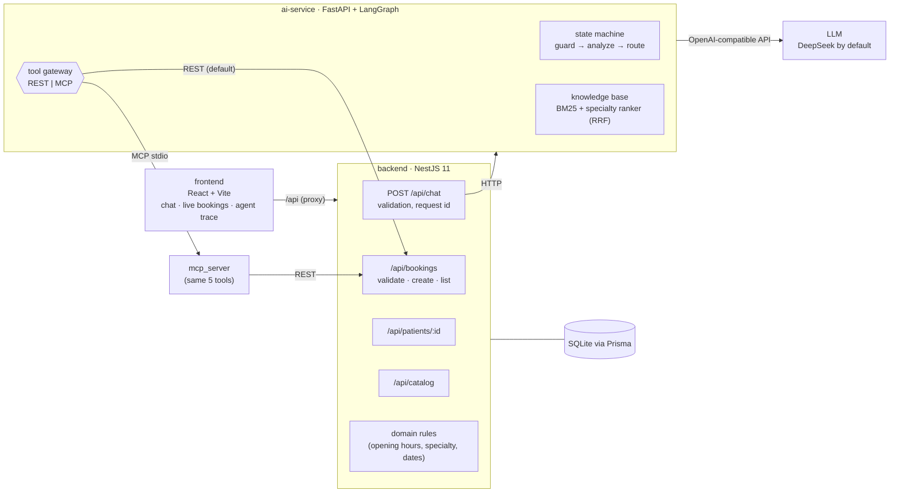
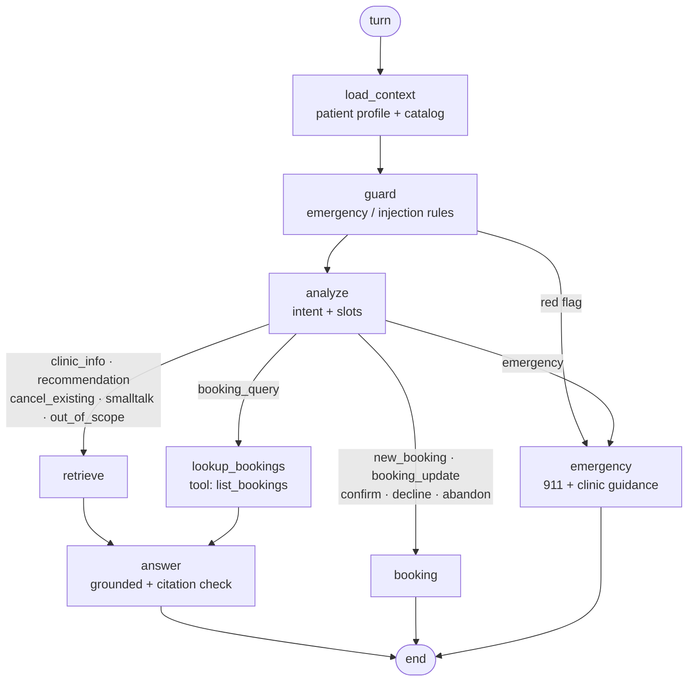
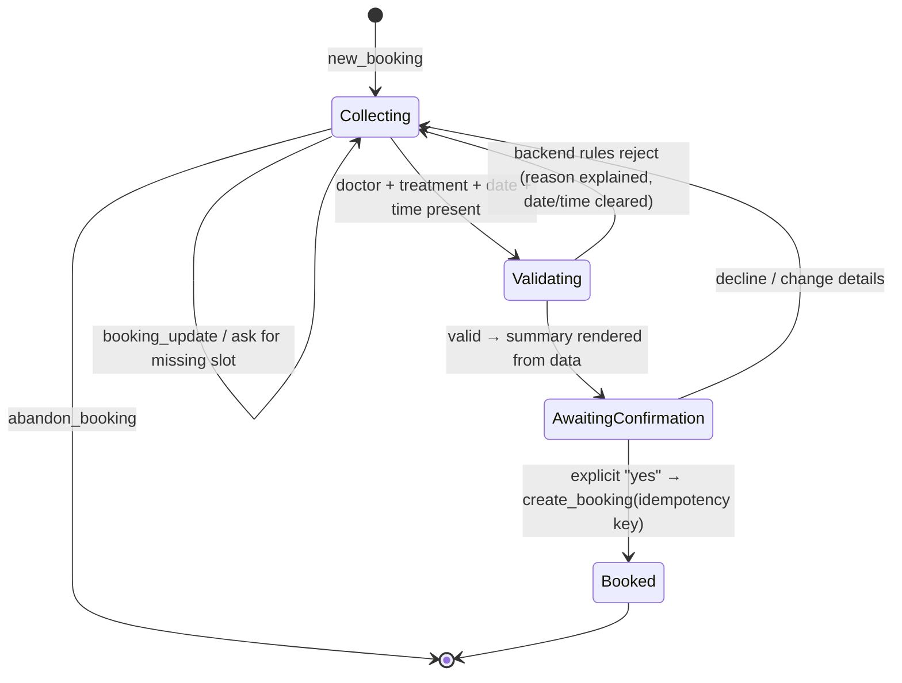
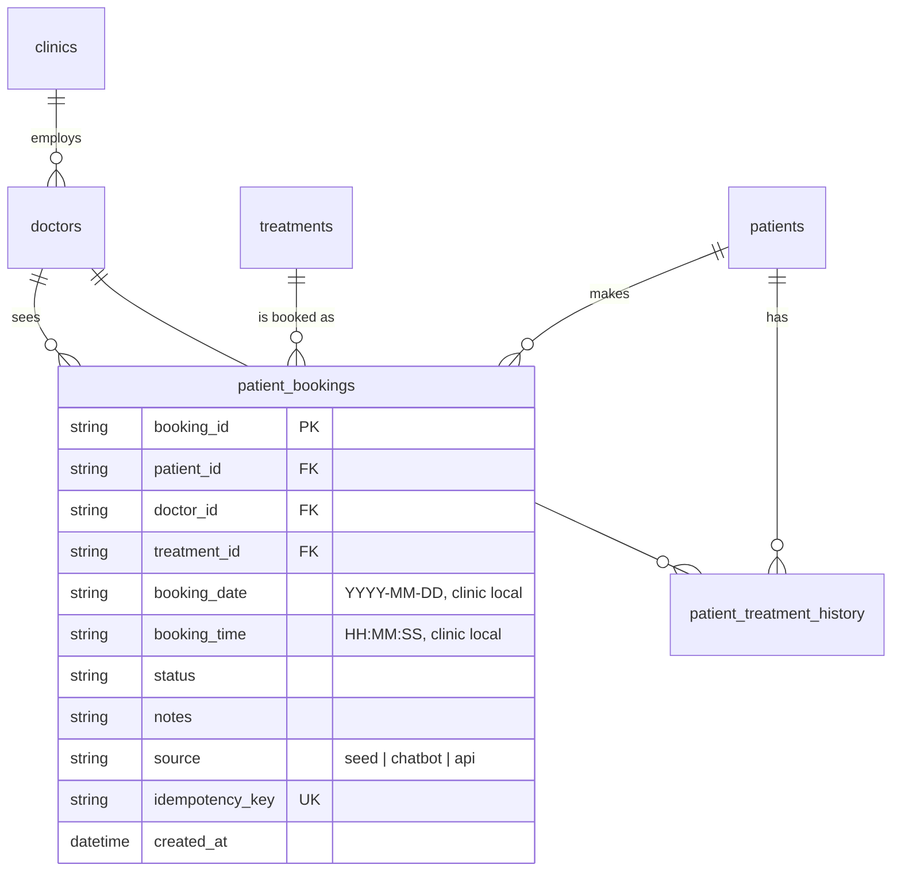

# ClinicPilot AI - Technical Design

This document explains the architecture, the intent recognition approach, the agent state machine and tool calling (REST and MCP), retrieval, the database schema, safety, and how the system is tested and evaluated. Setup instructions are in [README.md](README.md).

## 1. Goals and guiding principle

The assignment values **clean architecture, intent routing, AI orchestration / tool-calling quality, and database persistence**. One principle drives the design:

> **The LLM understands language; code makes decisions.**
> The model classifies intent, extracts booking details and writes natural answers. Deterministic code resolves names to real ids, validates every slot against the clinic rules, decides when a booking is written, and renders the numbers the patient sees.

This keeps the assistant pleasant to talk to while making the parts that must be correct (who, what, when, price, which patient) impossible for the model to get wrong.

## 2. Architecture

| Service | Stack | Responsibility |
|---|---|---|
| `backend/` | NestJS 11, Prisma 6, SQLite, class-validator, Swagger | Owns all data and every business rule. Seeds from CSV. Single gateway for the UI (`/api/chat` forwards to the AI service). |
| `ai-service/` | Python 3.11+, FastAPI, LangGraph, LangChain, MCP SDK | Conversation state machine, intent routing, retrieval, slot filling, tool calls. **Never touches the database directly.** |
| `frontend/` | React 19, Vite, TypeScript, plain CSS | Demo workbench: chat, live bookings table, agent trace, transcript summarizer. |

**Why three services.** It matches the suggested structure and gives a clean separation of concerns: the AI service can be replaced or scaled without touching data integrity, and every write goes through one validated API. The UI talks only to the backend, so the AI service is not exposed publicly.

**Why NestJS for the backend.** Typed DTOs with declarative validation, dependency injection, global exception filters and Swagger come built in, which is exactly the "modular architecture, validation, error-handling middleware" the brief asks for. The AI service is Python because that is where the agent ecosystem (LangGraph, MCP SDK) is strongest.

## 3. Intent recognition

Each turn makes **one structured LLM call** (`analyze`) that returns a validated Pydantic object, `TurnAnalysis`:

| Field | Purpose |
|---|---|
| `intent` | One of 12 enumerated intents (below) |
| `confidence` | 0-1, shown in the trace |
| `specialty` | Best-matching specialty for described needs, constrained to specialties that exist in the data |
| `doctor`, `treatment` | Id or name the patient referred to (including pronouns resolved from history: "book me with **her**") |
| `date`, `time` | Resolved to `YYYY-MM-DD` and 24h `HH:MM` using a 21-day calendar injected into the prompt |
| `notes` | Short reason for the visit |

Intents: `clinic_info`, `recommendation`, `booking_query`, `new_booking`, `booking_update`, `confirm_booking`, `decline_booking`, `abandon_booking`, `cancel_existing`, `emergency`, `smalltalk`, `out_of_scope`.

Combining classification and slot extraction in one call keeps latency low (median turn ~1.2 s end to end) and lets the model use the same context for both. The prompt includes the live doctor and treatment lists (ids, names, specialties), the current booking draft and whether a summary is awaiting confirmation, so the model can tell "10am please" (a `booking_update`) from a new request.

Code then post-processes the result:
- **Rule fast path:** while a summary is awaiting confirmation, a bare "yes" / "no" is classified by regex without calling the model (0 tokens, ~10 ms). Anything longer ("no, make it 11am") goes to the model so the correction is kept.
- **Consistency rules:** `confirm_booking` without a pending summary is downgraded to `new_booking`/`booking_update`; unknown specialties are normalised or dropped; malformed dates/times are discarded.
- **Graceful degradation:** if the model call fails, the turn falls back to a safe intent and the trace records `analyze_failed` instead of crashing.

## 4. Agent state machine (LangGraph)

- **Explicit graph, not a free-running agent.** Booking is a regulated, auditable action; every path is visible, testable and reproducible. Flexibility lives inside nodes (the LLM), control lives in the edges (code).
- **Persistent conversation state.** A LangGraph `SqliteSaver` checkpointer stores, per session: message history, the booking draft and the awaiting-confirmation flag. The patient can ask "how much does she charge?" in the middle of a booking and continue afterwards; the answer node reminds them what is still missing.
- **Trace.** Every node appends `{step, detail, ms}`; tool calls record name, transport, args, success and latency; token usage is summed per turn. The UI shows this in the "Agent trace" panel.

### Booking flow (slot filling)

1. **Merge.** Extracted names are resolved to real ids by code (`resolve_doctor`, `resolve_treatment`: id, full name, surname, first name, "the dermatologist").
2. **Infer when unambiguous.** Doctor known and they offer exactly one treatment (Dr. Rostova → Dermatology Consultation) → fill it. Treatment known with exactly one provider → fill the doctor. A specialty with one doctor → fill both. Otherwise ask, listing only compatible options with fees and durations.
3. **Explain conflicts.** "Dermatology consultation with Dr. Jenkins" → "Dermatology Consultation isn't offered by Dr. Sarah Jenkins (General Practice)"; the mentioned treatment is kept and its only provider is proposed.
4. **Validate before confirming.** A complete draft is dry-run against `POST /api/bookings/validate` (the same rules as create). If rejected, the reason is shown ("The clinic is closed on Sat…") and only date/time are cleared.
5. **Confirm (human in the loop).** The summary (patient, service, price, doctor, fee, date, time, address, preparation, allergies) is rendered from database values by a template, not generated. Nothing is written until the patient says yes.
6. **Create idempotently.** `create_booking` carries `idempotencyKey = sha256(patient, doctor, treatment, date, time)`. A repeated confirmation returns the original booking (`idempotentReplay: true`, HTTP 200) instead of a duplicate.
7. **Reset.** The draft is cleared; the UI table refreshes and highlights the new row.

## 5. Tool calling: REST and MCP

The agent depends on a `ToolGateway` with five tools:

| Tool | Backend endpoint | Used by |
|---|---|---|
| `get_patient_profile` | `GET /api/patients/:id` | every turn (personal context: allergies, bookings, history) |
| `list_bookings` | `GET /api/bookings?patientId=` | booking queries |
| `get_catalog` | `GET /api/catalog` | knowledge base (cached after first load) |
| `validate_booking` | `POST /api/bookings/validate` | before showing the confirmation summary |
| `create_booking` | `POST /api/bookings` | after explicit confirmation |

Two interchangeable implementations, selected by `TOOL_TRANSPORT`:

- **`rest` (default):** direct HTTP calls with `httpx`.
- **`mcp`:** the same tools exposed by `ai-service/app/mcp_server.py` (official MCP Python SDK v2, `MCPServer`). The agent keeps **one long-lived stdio session** owned by a background event loop; requests are queued to it, so each call costs ~5 ms after start-up instead of spawning a process per call. Tool failures are returned as structured `{"error": {...}}` payloads.

Both paths end at the same backend endpoints, so validation and persistence exist in exactly one place. The MCP server is also usable on its own by any MCP client (`python -m app.mcp_server`).

**Why the model does not call `create_booking` directly.** In a free tool-calling loop the model decides when to write. Here the graph calls write tools only from the confirmed state, which removes the classic failure mode of an agent booking on an ambiguous "sounds good" or under a prompt injection.

## 6. Retrieval (RAG) and recommendations

The dataset is small (2 clinics, 4 doctors, 5 treatments), so retrieval favours transparency over infrastructure:

- **Cards.** Each clinic, doctor and treatment becomes a self-contained text card with a stable id (`C001`, `D103`, `T003`) that answers cite. Cards are enriched with relations the CSVs do not store explicitly (a doctor's card lists the treatments they can perform; a clinic card lists its doctors).
- **Hybrid ranking with Reciprocal Rank Fusion (k = 60):**
  1. **Lexical:** BM25 over card text, strong for names, fees, hours, policies.
  2. **Semantic:** the specialty inferred by the model from the patient's description ("itchy rash" → Dermatology), which BM25 alone misses because "rash" appears nowhere in the data. A unit test asserts exactly this case.
  
  Swapping in an embedding index would only replace the second ranker.
- **Grounded answers.** The answer prompt allows only the supplied FACTS, requires a citation after each fact, and forbids diagnosis or medication advice. A post-check (`check_citations`) removes any citation that does not point to a retrieved source and records it in the trace.
- **Personalisation.** Patient P001's profile (allergies: Penicillin, Peanuts; bookings; visit history) is injected every turn. Recommendations remind the patient to mention allergies; summaries list them.

## 7. Database schema

- Tables and columns keep the CSV names (`@@map`/`@map`), so the database reads like the source data while the TypeScript model is camelCase.
- `patient_bookings` adds `source` (shows which rows the chatbot created), `idempotency_key` (unique, prevents duplicates) and `created_at`, plus an index on `(patient_id, booking_date)`.
- The seed (`prisma/seed.ts`) upserts every CSV row by primary key: re-running never duplicates rows and never deletes chatbot bookings. `npm run db:demo-reset` removes only non-seed bookings to restart a demo.
- Booking ids continue the existing sequence (`B1005`, `B1006`, …) inside a transaction; if a concurrent insert takes the same id the create is retried, and a concurrent request with the same idempotency key is answered as a replay.
- SQLite keeps local setup to zero services; the Prisma schema moves to PostgreSQL/MySQL by changing the provider.

### Business rules (backend, `src/domain/clinic-rules.ts`)

| Rule | Detail |
|---|---|
| Entities exist | patient, doctor, treatment (404 with a code otherwise) |
| Specialty compatibility | treatment category → allowed specialties (see assumptions) |
| Not in the past | compared with "today" in the **clinic's timezone** (inferred from the address: NY → America/New_York, CA → America/Los_Angeles); a time earlier than now on the same day is rejected; impossible dates (2026-02-30) fail validation |
| Inside opening hours | parses strings like `Mon-Fri: 8:00 AM - 6:00 PM, Sat: 9:00 AM - 1:00 PM, Sun: Closed`; the whole appointment (start + duration) must fit |
| Conflicts | not checked, as allowed by the brief |

Errors use one envelope: `{"error": {"code", "message", "details", "requestId"}}` (global exception filter). The agent turns `BOOKING_INVALID` details into a plain-language explanation.

## 8. Safety and guardrails

| Layer | What it does |
|---|---|
| Emergency guard (rules, before the LLM) | Red-flag phrases (chest pain, can't breathe, throat swelling, anaphylaxis, …) short-circuit to 911 and each clinic's emergency instructions, plus an epinephrine reminder for the peanut allergy. No booking, no LLM call. |
| Medical scope | No diagnosis, no medication advice; recommendations carry a disclaimer. Allergy questions explain there is no allergist and that a GP can assess and refer. |
| Prompt injection | Patterns such as "ignore previous instructions" or references to another patient are flagged. The patient id is set by the gateway for the session (always P001 in this demo), never by the model, so a message cannot make the agent read or book for another patient; the reply says so. (API-level authorisation is out of scope; see limitations.) |
| Grounding | Answers use only supplied facts; unsupported citations are removed. |
| Write safety | Writes only after explicit confirmation; backend re-validates; idempotency key. |
| Input validation | DTO validation on every endpoint (`whitelist`, `forbidNonWhitelisted`), message length limits, session-id pattern. |

## 9. Testing and evaluation

| Suite | Scope | Result |
|---|---|---|
| Backend unit (`npm test`) | opening-hours parser, closed days, appointment overrun, specialty mapping, timezone | 5 passed |
| Backend API (`npm run test:e2e`) | real Nest app + fresh SQLite: list, profile, create, idempotent replay, rule violations (3 at once), dry-run validation, DTO validation, impossible date, snake_case `patient_id` on `/api/chat`, 404 | 11 passed |
| AI service (`pytest`, offline) | full agent with a rule-based `FakeLLM` and in-memory backend: routing, slot filling, inference, confirmation gate, correction after the summary, closed-day rejection, emergency short-circuit, injection, abandon, session isolation, retrieval, entity resolution, citation guard, **MCP server contract test** (in-process MCP client) | 19 passed |
| Frontend | ESLint + type-checked production build | clean |
| **Scenario evals** (`make eval`, real LLM) | 24 multi-turn conversations, 36 turns, 89 checks | see below |

CI (`.github/workflows/ci.yml`) runs the backend suites, the AI-service suite on Python 3.11 and 3.12, the frontend lint/build and a `docker compose build` on every push. The AI tests use `LLM_PROVIDER=fake`, so CI needs no API key and is deterministic.

### Scenario evaluation (DeepSeek `deepseek-chat`, 2026-10-22)

| Metric | Value |
|---|---|
| Cases passed | 24 / 24 |
| Intent accuracy | 36 / 36 turns (100%) |
| Checks passed | 89 / 89 (intent, citations, tools, reply content, confirmation state, booking outcome) |
| Booking outcome accuracy | 13 / 13 (booked exactly when expected, never otherwise) |
| Latency p50 / p95 | 1.2 s / 2.4 s |
| Tokens per turn (avg) | ~1,750 |

Cases cover clinic info (hours, fees, languages, policies, preparation), symptom recommendations, booking queries, five booking paths (happy path, one-shot, pronoun reference after a recommendation, step-by-step slot filling, change before confirming), closed-day rejection, specialty mismatch, abandon, allergy, emergency, prompt injection, cancel request, out-of-scope and small talk. The latest report is written to `evals/results/latest.md`.

## 10. Observability

- Per-turn trace (steps, timings, tool calls, citations, tokens) returned by `/api/chat` and shown in the UI.
- Request id generated by the backend, propagated to the AI service and logged by both.
- Optional **Langfuse**: set `LANGFUSE_PUBLIC_KEY` / `LANGFUSE_SECRET_KEY` and every LLM call (analyze, compose, summarize) is traced with tokens and latency. Tracing failures never affect the request.

## 11. Bonus features

- **Transcript summarizer:** `POST /api/summarize` → structured `MedicalSummary` (`chief_complaint`, `diagnosis`, `medication[]`, `doctor_instructions[]`, plus `allergies_mentioned[]`, `follow_up`) via schema-constrained output, one automatic retry. UI tab included.
- **Containers:** `docker-compose.yml` (backend migrates and seeds on start; UI served by nginx on :8080) and a reference `k8s/clinicpilot.yaml`.
- **MCP server** usable by external MCP clients.

## 12. Assumptions

- **Single patient:** the user is always P001 (John Doe), injected by the backend gateway; no authentication.
- **Treatment ↔ specialty mapping** (not present in the CSVs): Preventative Care → General Practice; Pediatrics → Pediatrics; Dermatology → Dermatology; Immunization → General Practice or Pediatrics; Orthopedics → Orthopedics.
- **Dates and times** are clinic-local. The backend validates each booking in its own clinic's timezone; the agent resolves relative dates ("next Monday") in `CLINIC_TIMEZONE` (default America/New_York). `CLINIC_TODAY` pins the date for demos and tests.
- **Cancelling or rescheduling existing bookings** is out of scope; the assistant gives the clinic's phone and cancellation policy.
- **Data observation:** seeded booking B1004 (Dr. Wilson, 2026-11-15) falls on a Sunday when Metro Care is closed. Seed data is loaded as-is; new bookings are validated.

## 13. Limitations and next steps

- Authentication and multi-patient access control (the patient id would come from the auth token).
- Availability and conflict checks with doctor calendars; cancellation and rescheduling tools.
- PostgreSQL and multiple AI-service workers (the in-process lock that serialises turns would be replaced by per-session locking).
- Embedding-based retrieval once the knowledge base grows beyond a few dozen documents.
- Streaming responses to the UI.
- Larger evaluation set with human-labelled conversations, run in CI against a staging model.
