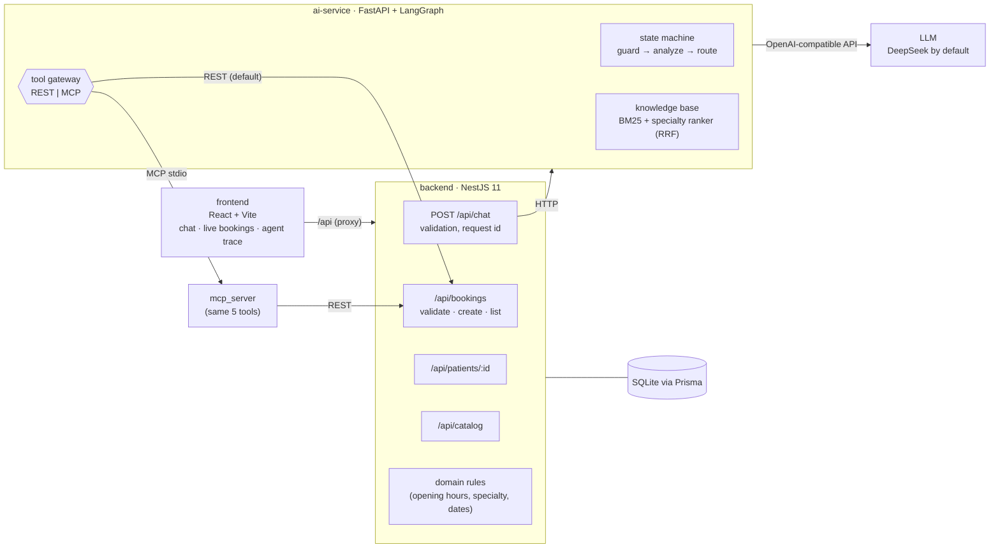
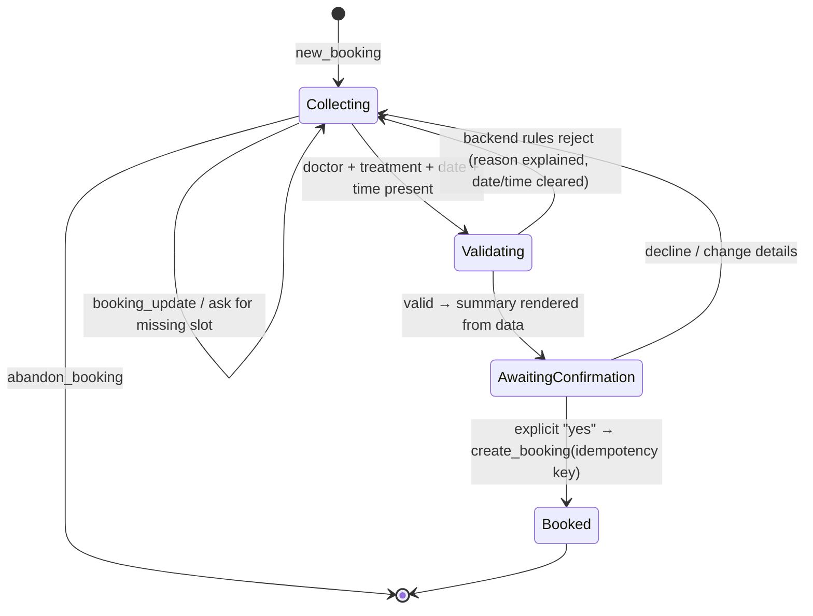
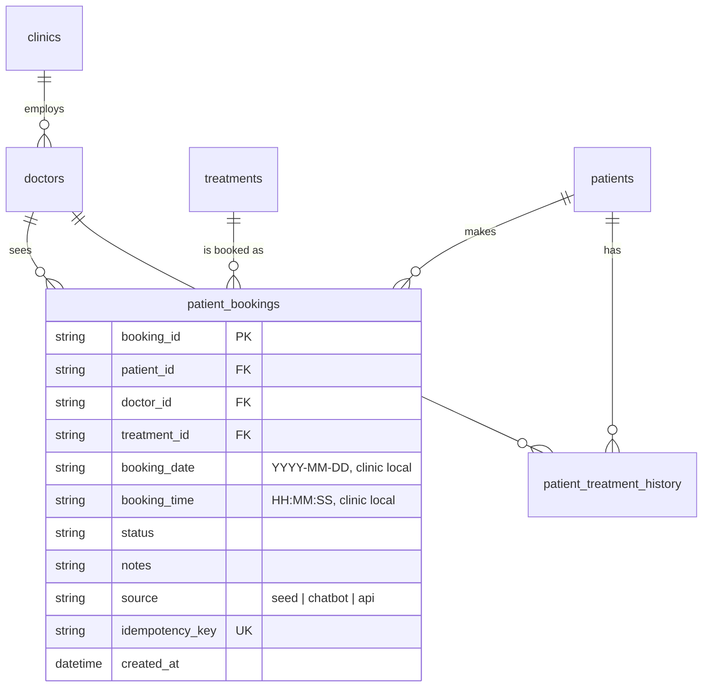

# ClinicPilot AI - Technical Design

This document explains the architecture, the intent recognition approach, the agent state machine and tool calling (REST and MCP), retrieval, the database schema, safety, and how the system is tested and evaluated. Setup instructions are in [README.md](README.md).

## 1. Goals and guiding principle

The assignment values **clean architecture, intent routing, AI orchestration / tool-calling quality, and database persistence**. One principle drives the design:

> **The LLM understands language; code makes decisions.**
> The model classifies intent, extracts booking details and writes natural answers. Deterministic code resolves names to real ids, validates every slot against the clinic rules, decides when a booking is written, and renders the numbers the patient sees.

This keeps the assistant pleasant to talk to while making the parts that must be correct (who, what, when, price, which patient) impossible for the model to get wrong.

## 2. Architecture



| Service | Stack | Responsibility |
|---|---|---|
| `backend/` | NestJS 11, Prisma 6, SQLite, class-validator, Swagger | Owns all data and every business rule. Seeds from CSV. Single gateway for the UI (`/api/chat` forwards to the AI service). |
| `ai-service/` | Python 3.11+, FastAPI, LangGraph, LangChain, MCP SDK | Conversation state machine, intent routing, retrieval, slot filling, tool calls. **Never touches the database directly.** |
| `frontend/` | React 19, Vite, TypeScript, plain CSS | Demo workbench: chat, live bookings table, agent trace, transcript summarizer. |

**Why three services.** It matches the suggested structure and gives a clean separation of concerns: the AI service can be replaced or scaled without touching data integrity, and every write goes through one validated API. The UI talks only to the backend, so the AI service is not exposed publicly.

**Why NestJS for the backend.** Typed DTOs with declarative validation, dependency injection, global exception filters and Swagger come built in, which is exactly the "modular architecture, validation, error-handling middleware" the brief asks for. The AI service is Python because that is where the agent ecosystem (LangGraph, MCP SDK) is strongest.

## 3. Intent recognition

Each turn makes **one structured LLM call** (`analyze`) that returns a validated Pydantic object, `TurnAnalysis`:

| Field | Purpose |
|---|---|
| `intent` | One of 12 enumerated intents (below) |
| `confidence` | 0-1, shown in the trace |
| `specialty` | Best-matching specialty for described needs, constrained to specialties that exist in the data |
| `doctor`, `treatment` | Id or name the patient referred to (including pronouns resolved from history: "book me with **her**") |
| `date`, `time` | Resolved to `YYYY-MM-DD` and 24h `HH:MM` using a 21-day calendar injected into the prompt |
| `notes` | Short reason for the visit |

Intents: `clinic_info`, `recommendation`, `booking_query`, `new_booking`, `booking_update`, `confirm_booking`, `decline_booking`, `abandon_booking`, `cancel_existing`, `emergency`, `smalltalk`, `out_of_scope`.

Combining classification and slot extraction in one call keeps latency low (median turn ~1.2 s end to end) and lets the model use the same context for both. The prompt includes the live doctor and treatment lists (ids, names, specialties), the current booking draft and whether a summary is awaiting confirmation, so the model can tell "10am please" (a `booking_update`) from a new request.

Code then post-processes the result:
- **Rule fast path:** while a summary is awaiting confirmation, a bare "yes" / "no" is classified by regex without calling the model (0 tokens, ~10 ms). Anything longer ("no, make it 11am") goes to the model so the correction is kept, and a model-classified confirmation is accepted only if the message contains an explicit affirmative ("yes", "go ahead", "确认", …) - a doctor's name alone is never a confirmation.
- **Consistency rules:** `confirm_booking` without a pending summary is downgraded to `new_booking`/`booking_update`; unknown specialties are normalised or dropped; malformed dates/times are discarded.
- **Graceful degradation:** if the model call fails, the turn falls back to a safe intent and the trace records `analyze_failed` instead of crashing.

## 4. Agent state machine (LangGraph)


- **Explicit graph, not a free-running agent.** Booking is a regulated, auditable action; every path is visible, testable and reproducible. Flexibility lives inside nodes (the LLM), control lives in the edges (code).
- **Persistent conversation state.** A LangGraph `SqliteSaver` checkpointer stores, per session: message history, the booking draft and the awaiting-confirmation flag. The patient can ask "how much does she charge?" in the middle of a booking and continue afterwards; the answer node reminds them what is still missing. See "Memory" below for how history is bounded and what is remembered across sessions.
- **Trace.** Every node appends `{step, detail, ms}`; tool calls record name, transport, args, success and latency; token usage is summed per turn. The UI shows this in the "Agent trace" panel.

### Booking flow (slot filling)



1. **Merge.** Extracted names are resolved to real ids by code (`resolve_doctor`, `resolve_treatment`: id, full name, surname, first name, "the dermatologist").
2. **Infer when unambiguous.** Doctor known and they offer exactly one treatment (Dr. Rostova → Dermatology Consultation) → fill it. Treatment known with exactly one provider → fill the doctor. A specialty with one doctor → fill both. Otherwise ask, listing only compatible options with fees and durations.
3. **Explain conflicts.** "Dermatology consultation with Dr. Jenkins" → "Dermatology Consultation isn't offered by Dr. Sarah Jenkins (General Practice)"; the mentioned treatment is kept and its only provider is proposed.
4. **Validate before confirming.** A complete draft is dry-run against `POST /api/bookings/validate` (the same rules as create). If rejected, the reason is shown ("The clinic is closed on Sat…") and only date/time are cleared.
5. **Confirm (human in the loop).** The summary (patient, service, price, doctor, fee, date, time, address, preparation, allergies) is rendered from database values by a template, not generated. Nothing is written until the patient says yes.
6. **Create idempotently.** `create_booking` carries `idempotencyKey = sha256(patient, doctor, treatment, date, time)`. A repeated confirmation returns the original booking (`idempotentReplay: true`, HTTP 200) instead of a duplicate.
7. **Reset.** The draft is cleared; the UI table refreshes and highlights the new row.

### Memory (short-term and long-term)

Implemented in `ai-service/app/memory.py`, wired into the graph in `agent.py`. Four layers, from hardest to softest:

| Layer | Content | Storage | Lifetime |
|---|---|---|---|
| Facts | allergies, bookings, visit history | backend database, read with tools every turn | permanent; the database is the only source of truth |
| Short-term | booking draft (structured), recent turns, rolling summary of older turns | LangGraph checkpointer, thread `patient:session` | one conversation |
| Long-term | preferences (language, time of day, usual doctor, clinic; enumerated fields only, no free text) and episodes (two-sentence summaries of past conversations) | LangGraph `BaseStore` (`SqliteStore`; `PostgresStore` + pgvector in production), namespace `("tenant", t, "patient", id, kind)` | 365-day retention, erasable |
| Governance | provenance, audit log, items for staff review, erasure records | same store (`audit`, `candidates`, `erasures`) | follows the patient |

**Short-term.** The model sees a token-budgeted window of whole turns: `trim_messages(strategy="last", start_on="human", token_counter="approximate")`, 1,200 tokens and at most 8 turns. As soon as the history no longer fits (budget or turn cap), one LLM call folds the oldest turns into `summary` until only half the budget remains (high/low watermark, as in LangMem's `SummarizationNode`), and the folded turns are dropped from the stored state. So every message is either in the window or in the summary (never invisible), checkpoints stay bounded, and the freed half-budget means the next few turns need no summarisation call. The newest turn is always kept, even if it alone exceeds the budget. User messages flagged as possible injection are redacted before summarising. The summary is passed to `analyze` and `answer` as data, never as a citable source. The booking draft is separate structured state and is never trimmed.

**Long-term, write path (off the hot path).** A rule gate (`should_extract`) skips messages without preference or medical cues and messages flagged as possible injection, so most turns cost nothing extra. Otherwise a single-thread background worker makes one structured call (`PreferenceUpdate`) and `apply_preferences` validates it in code: enumerated fields only; a doctor must be named (id or surname, not a specialty) and a clinic identified unambiguously; the message must be the patient talking about themselves and not about a relative ("which doctors speak Spanish?" or "...for my mother" are rejected and audited if the model proposes anything). Medical statements ("I'm allergic to latex") never become preferences or prompt memory: they are stored verbatim, once, and only from the latest message, as `pending_staff_review` items for staff, and are never shown to the model. Each change keeps the previous value and source (session, message hash, extractor model) and is written to the audit log. When a conversation ends (`POST /v1/sessions/{id}/end`, called by the UI's "Start a new conversation"), it is summarised into one episode; sentences with medical terms and instruction-like text are removed from the summary, topics and open item before storing. Episodes older than the retention period are deleted on disk (max 50 per patient).

**Long-term, read path.** `load_context` recalls the profile and up to three episodes that share terms with the message (IDF `log(1+N/df)`, blended 70/30 with recency; Okapi BM25's IDF is zero or negative for terms in half of a tiny per-patient collection); with no overlap, only the most recent episode. A new preference is written in the background and recalled from the next turn; reminders are skipped when the current message itself talks about the same thing. They are rendered as data, labelled "may be outdated; the latest message and the database always win". Memory only suggests ("last time you told us you prefer Dr. Elena Rostova - would you like them again?"); it never fills a booking slot.

**Erasure.** `DELETE /v1/patients/{id}/memory` sets a tombstone (background writes queued before it are dropped, so erasure never waits for the LLM), deletes every store item of the patient and every checkpoint thread `patient:*` (`delete_thread`), and records the erasure with a hash of the id only.

**Why not Mem0, Letta or LangMem.** LangGraph's own store keeps the data in our database (simplest compliance story) and adds no service. LangMem's patterns (profile vs collection, background extraction) are followed, but the package has not had a release since 0.0.30 (Oct 2025). Mem0's reported scores are vendor-reported on its hosted platform. Letta would replace the state machine. A temporal graph (Graphiti) becomes worth it when facts change often and history must be queried.

## 5. Tool calling: REST and MCP

The agent depends on a `ToolGateway` with five tools:

| Tool | Backend endpoint | Used by |
|---|---|---|
| `get_patient_profile` | `GET /api/patients/:id` | every turn (personal context: allergies, bookings, history) |
| `list_bookings` | `GET /api/bookings?patientId=` | booking queries |
| `get_catalog` | `GET /api/catalog` | knowledge base (cached after first load) |
| `validate_booking` | `POST /api/bookings/validate` | before showing the confirmation summary |
| `create_booking` | `POST /api/bookings` | after explicit confirmation |

Two interchangeable implementations, selected by `TOOL_TRANSPORT`:

- **`rest` (default):** direct HTTP calls with `httpx`.
- **`mcp`:** the same tools exposed by `ai-service/app/mcp_server.py` (official MCP Python SDK v2, `MCPServer`). The agent keeps **one long-lived stdio session** owned by a background event loop; requests are queued to it, so each call costs ~5 ms after start-up instead of spawning a process per call. Tool failures are returned as structured `{"error": {...}}` payloads.

Both paths end at the same backend endpoints, so validation and persistence exist in exactly one place. The MCP server is also usable on its own by any MCP client (`python -m app.mcp_server`).

**Why the model does not call `create_booking` directly.** In a free tool-calling loop the model decides when to write. Here the graph calls write tools only from the confirmed state, which removes the classic failure mode of an agent booking on an ambiguous "sounds good" or under a prompt injection.

## 6. Retrieval (RAG) and recommendations

The dataset is small (2 clinics, 4 doctors, 5 treatments), so retrieval favours transparency over infrastructure:

- **Cards.** Each clinic, doctor and treatment becomes a self-contained text card with a stable id (`C001`, `D103`, `T003`) that answers cite. Cards are enriched with relations the CSVs do not store explicitly (a doctor's card lists the treatments they can perform; a clinic card lists its doctors).
- **Hybrid ranking with Reciprocal Rank Fusion (k = 60):**
  1. **Lexical:** BM25 over card text, strong for names, fees, hours, policies.
  2. **Semantic:** the specialty inferred by the model from the patient's description ("itchy rash" → Dermatology), which BM25 alone misses because "rash" appears nowhere in the data. A unit test asserts exactly this case.
  
  Swapping in an embedding index would only replace the second ranker.
- **Grounded answers.** The answer prompt allows only the supplied FACTS, requires a citation after each fact, and forbids diagnosis or medication advice. A post-check (`check_citations`) removes any citation that does not point to a retrieved source and records it in the trace.
- **Personalisation.** Patient P001's profile (allergies: Penicillin, Peanuts; bookings; visit history) is injected every turn. Recommendations remind the patient to mention allergies; summaries list them.

## 7. Database schema



- Tables and columns keep the CSV names (`@@map`/`@map`), so the database reads like the source data while the TypeScript model is camelCase.
- `patient_bookings` adds `source` (shows which rows the chatbot created), `idempotency_key` (unique, prevents duplicates) and `created_at`, plus an index on `(patient_id, booking_date)`.
- The seed (`prisma/seed.ts`) upserts every CSV row by primary key: re-running never duplicates rows and never deletes chatbot bookings. `npm run db:demo-reset` removes only non-seed bookings to restart a demo.
- Booking ids continue the existing sequence (`B1005`, `B1006`, …) inside a transaction; if a concurrent insert takes the same id the create is retried, and a concurrent request with the same idempotency key is answered as a replay.
- SQLite keeps local setup to zero services; the Prisma schema moves to PostgreSQL/MySQL by changing the provider.

### Business rules (backend, `src/domain/clinic-rules.ts`)

| Rule | Detail |
|---|---|
| Entities exist | patient, doctor, treatment (404 with a code otherwise) |
| Specialty compatibility | treatment category → allowed specialties (see assumptions) |
| Not in the past | compared with "today" in the **clinic's timezone** (inferred from the address: NY → America/New_York, CA → America/Los_Angeles); a time earlier than now on the same day is rejected; impossible dates (2026-02-30) fail validation |
| Inside opening hours | parses strings like `Mon-Fri: 8:00 AM - 6:00 PM, Sat: 9:00 AM - 1:00 PM, Sun: Closed`; the whole appointment (start + duration) must fit |
| Conflicts (beyond the brief) | no overlapping appointments for the doctor or the patient (treatment duration counts; back-to-back allowed); the error lists the doctor's free times that day. A partial unique index on `(doctor_id, booking_date, booking_time)` (not Cancelled) closes the race: a Prisma `P2002` becomes 409 `SLOT_TAKEN` (see §11) |

Errors use one envelope: `{"error": {"code", "message", "details", "requestId"}}` (global exception filter). The agent turns `BOOKING_INVALID` details into a plain-language explanation.

## 8. Safety and guardrails

| Layer | What it does |
|---|---|
| Emergency guard (rules, before the LLM) | Red-flag phrases (chest pain, can't breathe, throat swelling, anaphylaxis, …) short-circuit to 911 and each clinic's emergency instructions, plus an epinephrine reminder for the peanut allergy. No booking, no LLM call. |
| Medical scope | No diagnosis, no medication advice; recommendations carry a disclaimer. Allergy questions explain there is no allergist and that a GP can assess and refer. |
| Third-party bookings | Requests to book for a family member or another patient id are declined with the clinic phone numbers; nothing is written to the signed-in patient's record. |
| Prompt injection | Patterns such as "ignore previous instructions" or references to another patient are flagged. The patient id is set by the gateway for the session (always P001 in this demo), never by the model, so a message cannot make the agent read or book for another patient; the reply says so. (API-level authorisation is out of scope; see limitations.) |
| Grounding | Answers use only supplied facts; unsupported citations are removed. |
| Write safety | Writes only after explicit confirmation; backend re-validates; idempotency key. |
| Input validation | DTO validation on every endpoint (`whitelist`, `forbidNonWhitelisted`), message length limits, session-id pattern. |

## 9. Testing and evaluation

| Suite | Scope | Result |
|---|---|---|
| Backend unit (`npm test`) | opening-hours parser, closed days, appointment overrun, specialty mapping, timezone, overlap detection (back-to-back allowed), free-slot suggestions | 7 passed |
| Backend API (`npm run test:e2e`) | real Nest app + fresh SQLite: list, profile, create, idempotent replay, idempotency-key reuse (409) and `Idempotency-Key` header, rule violations (3 at once), dry-run validation, DTO validation, impossible date, snake_case `patient_id` on `/api/chat`, 404, overlapping slot rejected with free times, back-to-back allowed, same-patient clash, duplicate of an existing appointment, two simultaneous requests for one slot (only one wins), audio upload required / multipart forwarded | 19 passed |
| AI service memory (`tests/test_memory.py`, offline) | token window keeps whole turns and never empties, no gap (every message is in the window or the summary, checked turn by turn), turn cap folds too, rolling summary keeps early facts and drops folded turns, booking draft survives trimming, preferences across sessions with provenance, suggest-not-book, update keeps previous value + audit, withdrawal, catalog validation, no free-text profile fields, questions / third-party statements / injection not stored, medical statements parked for staff (only from the latest message, deduplicated) and kept out of episodes and prompts, per-patient isolation, episode recall ranking and skipping irrelevant episodes, no stale time-of-day reminder, retention on disk, erasure of memory + sessions with hashed record, tombstone drops queued writes, SqliteStore survives restart. Key guards were mutation-tested (remove the guard, the test fails: 11/11, `scripts/mutation_check.py`). | 35 passed |
| Memory acceptance (`scripts/memory_acceptance.py`, running stack, real LLM) | 21 checks across write, safety (incl. no duplicate staff-review items), guardrails, episodes, recall, update, facts-from-database, short-term summary and erasure; PASS/FAIL per check | 21/21 (DeepSeek, two consecutive runs, 2026-10-28); the original 30-scenario eval still 30/30 twice |
| AI service observability + audio (`tests/test_telemetry.py`, `tests/test_audio.py`, offline) | one trace per turn with graph nodes, session and pseudonymous user (in-memory span exporter); background memory span joins the turn's trace; payload masking; online scores; a turn succeeds with Langfuse down; grounding only in evaluation mode; doctor's notes reach the answer; audio upload → transcript → summary with a stub model, media-type / empty / silent / not-installed errors; real Whisper on the sample with `RUN_WHISPER=1` | 17 passed (+1 opt-in) |
| AI service (`pytest`, offline) | full agent with a rule-based `FakeLLM` and in-memory backend: routing, slot filling, inference, confirmation gate, correction after the summary, closed-day rejection, emergency short-circuit, injection, booking for a family member or another patient refused, unknown doctor not replaced, invalid calendar date explained, no pediatrician offered to adults, appointment list rendered from data (with closed-day flag), multi-part questions, child bookings refused even via follow-ups, pediatric services not booked on an adult record, a repeated "yes" after booking does not reopen it, the visit reason from an earlier turn is kept, a doctor name is not taken as a confirmation, a wrong-specialty doctor is not substituted, adults asking a pediatrician are redirected, abandon, session isolation, retrieval, entity resolution, citation guard, **MCP server contract test** (in-process MCP client, including list output), specialties the clinics don't offer answered before booking, slot taken between check and create (asks for another time) | 35 passed |
| Frontend | ESLint + type-checked production build | clean |
| **Scenario evals** (`make eval`, real LLM) | 32 multi-turn conversations | see below |
| **Black-box QA** (independent tester, real LLM) | 55 conversations + 30 direct API calls written without reading the code: date phrasings, typos, mind changes, Chinese/Cantonese, injection, other patients, double confirmation, concurrency, malformed requests | four rounds (47/55 → 48/55 → 50/55 → 54/55; 17/17 probes, 33/33 API checks), each round's findings fixed and turned into regression tests or eval cases, then re-run |

CI (`.github/workflows/ci.yml`) runs the backend suites, the AI-service suite on Python 3.11 and 3.12, the frontend lint/build and a `docker compose build` on every push. The AI tests use `LLM_PROVIDER=fake`, so CI needs no API key and is deterministic.

### Scenario evaluation (DeepSeek `deepseek-chat`, 2026-10-28, run when the set had 30 cases; now 32)

| Metric | Value |
|---|---|
| Cases passed | 30 / 30 |
| Intent accuracy | 43 / 43 turns (100%) |
| Checks passed | 112 / 112 (intent, citations, tools, reply content, confirmation state, booking outcome) |
| Booking outcome accuracy | 18 / 18 (booked exactly when expected, never otherwise) |
| Latency p50 / p95 | 1.19 s / 2.24 s |
| Tokens per turn (avg) | ~2,190 |

Cases cover clinic info (hours, fees, languages, policies, preparation), symptom recommendations, booking queries, five booking paths (happy path, one-shot, pronoun reference after a recommendation, step-by-step slot filling, change before confirming), closed-day rejection, specialty mismatch, abandon, allergy, emergency, prompt injection, cancel request, out-of-scope and small talk. The latest report is written to `evals/results/latest.md`.

## 10. Observability (Langfuse + OpenTelemetry)

```
browser -> NestJS (OTel: http, express, nest, undici)  --traceparent-->  FastAPI (OTel)  -->  OTel Collector -> Jaeger
                                                                          |
                                                                          +-> Langfuse (own provider): chat turn (agent)
                                                                              -> LangGraph nodes -> LLM generations
                                                                              -> background memory writes, scores
```

- **One trace id end to end.** The backend's fetch span injects W3C `traceparent`; FastAPI continues it; the Langfuse
  agent observation for the turn is created inside that context, so Jaeger (service spans) and Langfuse (LLM spans)
  share the trace id. Verified on a live turn: 15 spans across `clinicpilot-backend` and `clinicpilot-ai-service` in
  Jaeger and 29 observations under the same id in Langfuse.
- **Langfuse** (`app/telemetry.py`, self-hosted v4 in `observability/langfuse`): `propagate_attributes` sets session id,
  a pseudonymous user id (`u_` + salted hash, never the patient id) and tags; the LangChain `CallbackHandler` is passed to
  `graph.invoke`, so every node and generation nests under the turn (previously each LLM call was an isolated trace).
  Background memory writes run in a worker thread and are attached to the turn's trace id with their own session/user.
- **Privacy:** Langfuse uses its own `TracerProvider`, so prompts and patient text go only to Langfuse, never to the
  general trace backend; a `mask` hook redacts e-mails, phone numbers and dates of birth before export; the collector
  drops request bodies and query strings.
- **Online scores on every turn** (code-based, free): `citations_valid`, `guardrail` (none / emergency / injection /
  refusal), `intent_confidence`, `latency_ms`, `llm_calls`, `tokens`, `memory_recalled`; plus `user_feedback` through the API
  endpoint `POST /v1/feedback` (UI hook is a next step). The response carries `trace_id` and `trace_url`.
- **Fail-safe:** everything is optional (no keys / endpoint = no-op). The trace URL needs a project lookup with retries,
  so it is resolved once in the background, never on the request path; a test proves a turn succeeds with Langfuse down.
- **OpenTelemetry versions:** Python SDK 1.45.1 + `opentelemetry-instrumentation-fastapi/httpx` 0.66b1; Node
  `@opentelemetry/sdk-node` 0.223.0 (the last 2.x line, supports Node >= 20.6; 0.300 requires 22.15). Collector
  `otel/opentelemetry-collector-contrib:0.164.0`, Jaeger v2 `2.22.0`.

## 10b. Evaluation methodology (`evals/agent_eval.py`)

| Layer | Question | How |
|---|---|---|
| Outcome (code) | did it do the right thing? | intent, citations, tools, booking written, reply content (`evals/cases.json`, 32 cases) |
| Trajectory | did it take the right path? | `agentevals` trajectory match: node path == the intent's route (strict), expected tools called (superset) |
| Groundedness | is every claim supported? | LLM-as-judge (`openevals` `RAG_GROUNDEDNESS_PROMPT`) on answer turns, context = exactly what the model was allowed to use (rules + facts + conversation), returned by the AI service in evaluation mode (`EVAL_EXPOSE_GROUNDING=true`) |
| Memory | does memory help, safely? | `evals/memory_cases.json`: LongMemEval's five abilities (information extraction, multi-session reasoning, temporal reasoning, knowledge update, abstention) + 2 healthcare safety cases; each case starts from an empty memory, background writes are polled |
| Consistency | does it work every time? | `--repeat k`: pass@1 and pass^k (all k runs pass, as in tau-bench) |
| Performance / cost | fast and cheap enough? | latency p50/p95/max, tokens and LLM calls per turn, cost per turn at a given price |
| Regression gates | better than before? | `evals/gates.json`: absolute thresholds + "no worse than baseline" with tolerances; exit code 1 on regression |

- **Judge calibration** (`evals/judge_calibration.py`): 40 labelled items: faithful vs one-fact-changed answers built from
  the catalog, plus live agent replies and the same replies with one number changed or an invented service. Result:
  accuracy 1.0, Cohen's kappa 1.0, no false alarms. The judge runs through tool calling (DeepSeek rejects `json_schema`).
- **What the evaluation itself caught:** the first judge runs flagged answers that were in fact correct (the judge did not
  see the system facts or code-rendered dates); fixing the context, not the threshold, took groundedness from 0.81 to 1.0
  without making the judge lenient (re-calibrated). A 10-run A/B against the previous commit found that an empty
  "memory: none" block in the intent prompt shifted one case from 0/10 to 3/10 misroutes; the block is now omitted when
  empty.
- Every run is also a **Langfuse experiment** on dataset `clinicpilot-agent-eval` (scores per case, run-level metrics),
  comparable across runs in the UI.

## 11. Bonus features

- **Transcript summarizer:** `POST /api/summarize` → structured `MedicalSummary` (`chief_complaint`, `diagnosis`, `medication[]`, `doctor_instructions[]`, plus `allergies_mentioned[]`, `follow_up`) via schema-constrained output, one automatic retry. UI tab included.
- **Voice transcription summary:** `POST /api/summarize/audio` (multipart, ≤ 15 MB) → local speech-to-text with
  `faster-whisper` 1.2.1 (`small`, int8 on CPU, no PyTorch; PyAV pinned to 16.0.1 because 17+ removed an argument
  faster-whisper still passes) → the same structured summary. The recording is processed in memory / a temp file
  that is deleted immediately and never leaves the machine. A 37-second two-voice sample
  (`mock-data/audio/consultation-sample.mp3`) transcribes in about 4 s and summarises in about 6 s end to end.
- **Doctor's notes from the visit history:** the patient record given to the model includes each visit's reason,
  diagnosis, past prescription and the doctor's notes (`patient_treatment_history.csv`), so "what did the doctor
  recommend at my last checkup?" is answered from the record; past prescriptions are marked history-only.
- **Appointment conflicts (beyond the brief, which allows assuming every slot is free):** a doctor cannot have two
  overlapping appointments (each treatment's duration counts) and a patient cannot be in two at once; the error lists the
  doctor's free times that day. A partial unique index (`doctor_id, booking_date, booking_time` where status is not
  Cancelled) closes the race between check and insert: an e2e test fires two simultaneous requests for one slot, and
  without the index both succeed. On PostgreSQL an exclusion constraint would enforce overlaps in the database as well.
- **Containers and Kubernetes:** `docker-compose.yml` (non-root images, memory on the volume, tracing env); `k8s/` with
  probes, resource limits, non-root security contexts, ConfigMap/Secret, PVCs and `strategy: Recreate` for SQLite,
  deployed on a local kind cluster by `scripts/kind-up.sh`.
- **MCP server** usable by external MCP clients.

## 12. Assumptions

- **Single patient:** the user is always P001 (John Doe), injected by the backend gateway; no authentication.
- **Treatment ↔ specialty mapping** (not present in the CSVs): Preventative Care → General Practice; Pediatrics → Pediatrics; Dermatology → Dermatology; Immunization → General Practice or Pediatrics; Orthopedics → Orthopedics.
- **Dates and times** are clinic-local. The backend validates each booking in its own clinic's timezone; the agent resolves relative dates ("next Monday") in `CLINIC_TIMEZONE` (default America/New_York). `CLINIC_TODAY` pins the date for demos and tests.
- **Cancelling or rescheduling existing bookings** is out of scope; the assistant gives the clinic's phone and cancellation policy.
- **Language:** answers follow the patient's language (tested with Chinese and Cantonese); booking summaries and confirmations are English templates so the figures are always exact.
- **Appointment lists** are rendered from the database, not summarised by the model, so none can be omitted; bookings on a day the clinic is normally closed are flagged.
- **Data observation:** seeded booking B1004 (Dr. Wilson, 2026-11-15) falls on a Sunday when Metro Care is closed. Seed data is loaded as-is; new bookings are validated.

## 13. Limitations and next steps

- Authentication and multi-patient access control (the patient id would come from the auth token).
- Doctor calendars (leave, breaks); cancellation and rescheduling tools.
- PostgreSQL and multiple AI-service workers (the in-process lock that serialises turns would be replaced by per-session locking; `AsyncPostgresSaver` and `PostgresStore`; memory writes through a queue instead of an in-process worker).
- Semantic recall for long-term memory (an embedding index on the store) once patients have many episodes.
- Embedding-based retrieval once the knowledge base grows beyond a few dozen documents.
- Streaming responses to the UI.
- Larger evaluation set with human-labelled conversations, run in CI against a staging model.
